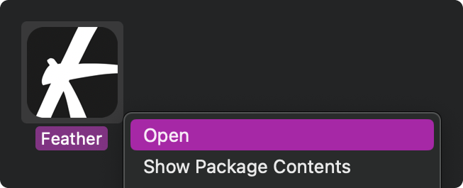
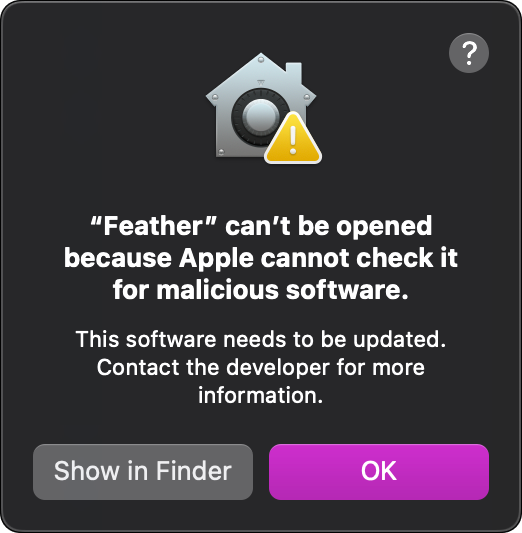
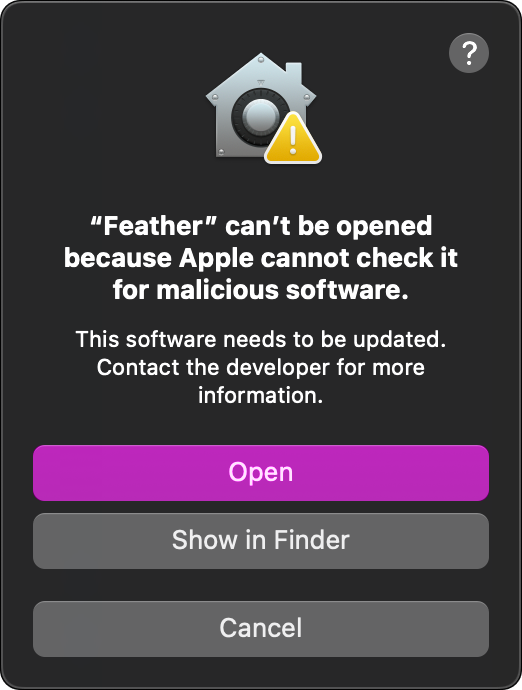

###### Feather


---

Imagine if Acrobxt and Brxdge weren't bloated and expensive.

- Open, edit and save PDFs and images. Play video. View folders.
- Moodboard, categorize, and performantly organize tens-of-thousands of files on an infinite canvas.

---

**[Download the latest release](https://github.com/polarisdigitallabs/feather-releases/releases/latest)**

## Which file do I need?

| System | File |
| --- | --- |
| Windows | `Feather-Setup-<version>.exe` |
| macOS (Apple Silicon) | `Feather-<version>-arm64.dmg` |
| Linux | `Feather-<version>.AppImage` or `feather_<version>_amd64.deb` |

## First launch

Feather isn't code-signed yet, so your system will warn you the first time you open it.

<details>
  <summary><b>Windows</b></summary>

  - On the "Windows protected your PC" screen, click **More info**, then **Run anyway**.
  - It may need to be re-opened after confirming this
</details>

<details>
  <summary><b>macOS</b></summary>

  - Open the `.dmg` and drag Feather into Applications, then open it from Applications.
  - If macOS says it can't verify Feather, or can't check it for malicious software, close the message.  
  Then **Right-click** or **Control-click** Feather in Applications, choose **Open**, and click **Open** again.  
  
    -   

    -   

    - (**Right-click** and open again)  
      

    - If that option isn't there, go to **System Settings → Privacy & Security**, scroll down and click **Open Anyway**. You only need to do this once.
  - If it says Feather "is damaged", run this once in Terminal, then open it again:
    ```
    xattr -cr /Applications/Feather.app
    ```
</details>

<details>
  <summary><b>Linux</b></summary>

  - run `chmod +x Feather-*.AppImage`, then open the AppImage.  
  For the `.deb`, run `sudo apt install ./feather_*_amd64.deb`.
</details>


## Updates

The installed Windows app and the Linux AppImage check for updates when they start and install them when you quit. You can also use **Help → Check for Updates…**.

On macOS, download new versions from the [releases page](https://github.com/polarisdigitallabs/feather-releases/releases) for now.

## Privacy

Once a day, Feather sends an anonymous check-in: its version, your OS and CPU type, your language setting, a random ID created when you first run it, and your rough location (country and city). **It never sends your files, file names, or anything you do in the app, and IP addresses aren't stored.** [Full privacy policy](https://featherview.app/privacy)

To turn it off, go to **Settings → General → Anonymous usage stats**.
